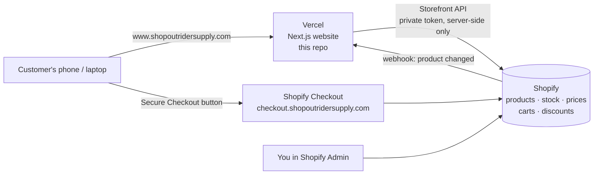

# OUTRIDER SUPPLY — Setup & Launch Guide

This guide takes you from "the code is ready" to "customers can buy". You don't need to be a developer. Follow the phases in order.

---

## 1. The approach we chose, and why

**We kept your existing Next.js site on Vercel and connected it to Shopify ("headless Shopify").**

| | A. Native Shopify (Heritage theme) | **B. Your site + Shopify (chosen)** | C. Shopify Hydrogen |
|---|---|---|---|
| Development complexity | Lowest | Medium, and already mostly built | Highest (a full rebuild in a new framework) |
| Initial cost | ~$0–$400 (free theme, maybe a paid one) | ~$0. The code is in this repo | High (rebuild) |
| Monthly cost | Shopify only | Shopify + Vercel Pro ($20) | Shopify only (Oxygen hosting is included) |
| Performance & SEO | Good | Excellent | Excellent |
| Shopify integration reliability | Native | Official Storefront API; very reliable | Native |
| Checkout security | Shopify checkout | **Same Shopify checkout** | Same Shopify checkout |
| Mobile | Good | Excellent (already responsive) | Excellent |
| Design customization | Limited to what the theme allows | Unlimited, and your design already exists | Unlimited |
| Product/inventory updates | Shopify Admin | **Shopify Admin** (identical) | Shopify Admin |
| Long-term scalability | Good | Excellent | Excellent |
| Maintain without a developer | Easiest: drag-and-drop page editor | Products, prices, stock, discounts and policies: yes. Page layout and copy changes: through Claude / v0 | Hard |

**Why B:** you already have a premium custom design that a theme can't easily match. Rebuilding it in Heritage would lose that. Rebuilding it in Hydrogen would mean starting over. Option B keeps everything you have and adds real shopping. **Shopify stays the place where you run the business:** products, photos, prices, sizes and colors, stock, collections, discounts, orders, payments and shipping are all managed in Shopify Admin. The website reads them automatically.

**The honest trade-off:** to change homepage text or page layouts, you edit code (with Claude or v0) instead of using a drag-and-drop editor. Products never need code.

> If you ever decide you'd rather have a drag-and-drop editor for everything, Option A is still available. Your Shopify products and collections would carry over unchanged.

---

## 2. Architecture



- **Product pages, collections and the bag** are on your website (Vercel).
- **Checkout and payment** happen on Shopify's hosted checkout. Card details never touch your site, so you don't need any extra security certification.
- **Secrets** (the Shopify token) live only in Vercel's server settings. The browser never sees them.
- **Updates:** when you change a product in Shopify, a webhook tells the site to refresh within seconds. The site also re-checks every 15 minutes as a backup.

### What was built

| Page | URL |
|---|---|
| Homepage | `/` |
| Shop All (sort by price/newest) | `/shop` |
| TRAIL / CAMP / RIDGE collections | `/collections/trail`, `/collections/camp`, `/collections/ridge` |
| Product detail (color + size selection, sold-out sizes, size-guide pop-up) | `/products/[handle]` |
| Bag (slide-out drawer + full page with discount codes) | `/cart` |
| Search | `/search?q=…` |
| Our Story, Size & Fit Guide, Contact, FAQ | `/our-story`, `/size-guide`, `/contact`, `/faq` |
| Shipping & Returns, Privacy, Terms (text pulled from Shopify) | `/shipping-returns`, `/privacy-policy`, `/terms` |
| Checkout | Shopify-hosted |

**Demo mode:** until you add your Shopify credentials, the site shows 18 sample tees built from your AI shoot images, so you can click through everything. The checkout button stays disabled until Shopify is connected.

### Where to edit things (no code knowledge needed for most)

| To change… | Edit in |
|---|---|
| Products, photos, prices, sizes, colors, stock | Shopify Admin → Products |
| Which products are in TRAIL / CAMP / RIDGE | Shopify Admin → Products → Collections |
| Collection banner image / description | Shopify Admin → Collections (overrides the defaults) |
| Discount codes | Shopify Admin → Discounts |
| Privacy, Terms, Shipping, Refund policy text | Shopify Admin → Settings → Policies |
| Email, Instagram, free-shipping threshold, return days | `lib/site.ts` |
| Fit descriptions & GSM | `lib/collections.ts` |
| Size chart measurements | `lib/size-guide.ts` |
| FAQ answers | `app/faq/page.tsx` |

---

## 3. Costs (verify current prices on shopify.com/pricing and vercel.com/pricing)

| Item | One-time | Monthly |
|---|---|---|
| Shopify **Basic** plan | — | $39 (or ~$29/mo billed yearly) |
| Shopify **Headless** sales channel | — | Free |
| Vercel **Pro** (required: Vercel's free Hobby plan is for non-commercial use only) | — | $20 |
| Domain `shopoutridersupply.com` | ~$12–20/year | — |
| Card processing (Shopify Payments, Basic plan) | — | ~2.9% + 30¢ per online order |
| Apps / paid theme | $0, none needed | $0 |
| **Total fixed** | **~$15** | **~$59** (+ processing fees) |

---

## 4. Phase-by-phase setup

### Phase 1 — Preview the site on your computer (10 min)

1. Install **Node.js 20+** from nodejs.org if you don't have it.
2. In Terminal, inside this project folder:

```bash
npx pnpm@9 install
```

```bash
npx pnpm@9 dev
```

3. Open http://localhost:3000. You'll see demo products. Try adding to bag, changing quantity and removing.

### Phase 2 — Set up Shopify (30–60 min)

1. **Plan:** Shopify Admin → Settings → Plan → choose **Basic**.
2. **Payments:** Settings → Payments → activate **Shopify Payments** (this enables cards, Shop Pay, Apple Pay and Google Pay).
3. **Products:** for each tee:
   - **Title**, **Description**, **Price**.
   - **Variants:** add option **`Color`** and option **`Size`** (spell them exactly like that). Sizes: S, M, L, XL, XXL.
   - Tip: in Shopify, when you edit the Color option you can give each color a **swatch color**. The site shows those swatches automatically.
   - **Images:** upload photos. Assign each variant its own photo, so picking a color switches the photo.
   - **Inventory:** turn on "Track quantity" and enter stock. Sold-out sizes are crossed out on the site automatically.
   - **Status:** Active, and make sure the **Headless** channel is ticked under "Sales channels" (after step 5).
4. **Collections:** Products → Collections → create three collections. The **handle** (the last part of the URL, shown under "Search engine listing") must be exactly:
   - `trail`, `camp`, `ridge`
   - Easiest: make them **automated** collections, e.g. "Product tag is equal to trail", then tag each product `trail`, `camp` or `ridge`.
5. **Headless channel (gives the site access):**
   - Shopify App Store → install **Headless** (by Shopify, free).
   - Sales channels → Headless → **Create storefront** → name it "Outrider website".
   - Open **Storefront API** → **Manage permissions** → make sure product, collection, inventory/stock, cart/checkout and policy access are enabled → Save.
   - Copy the **Private access token**. You'll paste it into Vercel in Phase 3. **Never put it in code, GitHub, email or chat.**
   - Back in **Products**, select all → "Include in sales channels" → **Headless**.
6. **Policies:** Settings → Policies → use Shopify's templates to create Privacy, Terms, Shipping and Refund policies. Adjust them to how you work. They appear on the site automatically.
7. **Shipping:** Settings → Shipping and delivery → set US rates. If you offer free shipping over $75, create that rate here. Then make sure `freeShippingThreshold` in `lib/site.ts` matches (or set it to `0` to hide the progress bar).

### Phase 3 — Connect the site to Shopify

**On your computer (optional, to test locally):**

1. Copy `.env.example` to a new file called `.env.local` in the project folder.
2. Fill in `SHOPIFY_STORE_DOMAIN` (e.g. `outrider-supply.myshopify.com`) and `SHOPIFY_STOREFRONT_PRIVATE_TOKEN`.
3. Restart `npx pnpm@9 dev`. The demo products are replaced by your real Shopify products, and the checkout button turns on.

`.env.local` is ignored by Git, so it never gets uploaded.

**On Vercel (the live site):**

1. vercel.com → your project → **Settings → Environment Variables**. Add these for **Production** and **Preview**:

| Name | Value |
|---|---|
| `SHOPIFY_STORE_DOMAIN` | `your-store.myshopify.com` |
| `SHOPIFY_STOREFRONT_PRIVATE_TOKEN` | the private token from Phase 2 |
| `SHOPIFY_API_VERSION` | `2026-07` |
| `SHOPIFY_WEBHOOK_SECRET` | from step 3 below |
| `NEXT_PUBLIC_SITE_URL` | `https://www.shopoutridersupply.com` |

2. Upgrade the Vercel team to **Pro**.
3. **Instant updates (webhooks):** Shopify Admin → Settings → Notifications → scroll to **Webhooks** → create these, each with format **JSON** and URL `https://www.shopoutridersupply.com/api/revalidate`:
   - Product update, Product creation, Product deletion
   - Collection update, Collection creation, Collection deletion
   - Inventory level update

   At the bottom of that page Shopify shows "Your webhooks will be signed with **…**". Copy that key into `SHOPIFY_WEBHOOK_SECRET` on Vercel.
4. Vercel → Deployments → **Redeploy** so the new variables take effect.

### Phase 4 — Domain, SSL and checkout domain

**Recommended setup:**

| Address | Points to | Purpose |
|---|---|---|
| `www.shopoutridersupply.com` | **Vercel** | The website (main address) |
| `shopoutridersupply.com` (no www) | **Vercel** → redirects to www | So both addresses work |
| `checkout.shopoutridersupply.com` | **Shopify** | Branded, secure checkout |

**Steps:**

1. **Vercel → Project → Settings → Domains:** add `www.shopoutridersupply.com` and `shopoutridersupply.com`. Set the non-www one to **redirect to www**. Vercel shows you the exact DNS records to add. Use those values.
2. **At your domain registrar's DNS settings** (or in Shopify Admin → Settings → Domains, if you bought the domain through Shopify), add:
   - `A` record, host `@` → the IP Vercel shows (usually `76.76.21.21`)
   - `CNAME` record, host `www` → the target Vercel shows (e.g. `cname.vercel-dns.com`)
   - `CNAME` record, host `checkout` → `shops.myshopify.com`
3. **Shopify Admin → Settings → Domains → Connect existing domain** → `checkout.shopoutridersupply.com` → then set it as the **primary domain**. Checkout pages, order-status pages and Shopify emails then use your brand's domain.
4. **SSL (the padlock):** automatic and free on both sides. Vercel issues certificates for www/root, and Shopify issues one for `checkout.`. It can take from a few minutes up to 48 hours after DNS changes.

**Avoid a duplicate storefront (important for SEO):** your Shopify store still has its own "Online Store" theme (Heritage). Customers and Google should never land there. In Shopify Admin → Online Store → Themes → … → **Edit code** → `layout/theme.liquid`, paste this right after `<head>`:

```liquid

  <meta name="robots" content="noindex, nofollow">
  <script>window.location.replace('https://www.shopoutridersupply.com' + window.location.pathname + window.location.search);</script>

```

Product and collection URLs (`/products/...`, `/collections/...`) are the same on both, so any old Shopify link lands on the right page of the new site. You do **not** need to customize Heritage any further.

### Phase 5 — Test before going live

Use Shopify's **test mode** first: Settings → Payments → Shopify Payments → **Enable test mode**. Then pay with Shopify's published test card numbers, listed in Shopify's help center under "Testing Shopify Payments".

---

## 5. Integration testing checklist

**Catalog**
- [ ] All products appear on `/shop`; each fit page shows only its own tees
- [ ] Change a price in Shopify → the site shows the new price within ~1 minute (webhook working)
- [ ] Set a size's stock to 0 → that size is crossed out and shows "Sold Out"
- [ ] Picking a color switches to that color's photo
- [ ] Sort by price and newest both work
- [ ] Search finds a product by name

**Bag**
- [ ] Add to Bag opens the drawer with the right color, size and quantity
- [ ] + / − and remove update the subtotal
- [ ] Bag is still there after refreshing or closing the browser
- [ ] A valid discount code applies on `/cart`; an invalid one shows an error

**Checkout (test mode)**
- [ ] "Secure Checkout" opens `checkout.shopoutridersupply.com` with the same items
- [ ] Test order completes, appears in Shopify Admin → Orders, and the confirmation email arrives
- [ ] After the order, the bag on the site is empty again
- [ ] Shipping rates and tax are correct for a few US states

**Every page, on a phone and on a desktop**
- [ ] Home, Shop, 3 collections, product, bag, Our Story, Size Guide, Contact, FAQ, Shipping & Returns, Privacy, Terms
- [ ] Menu, search, and the size-guide pop-up work on mobile

---

## 6. SEO & mobile (already built in)

- Every page has its own title, description and canonical URL. Product pages use Shopify's "Search engine listing" fields when you fill them in.
- Product pages include **structured data** (price, availability, brand), so Google can show rich results.
- `sitemap.xml` lists every product automatically, and `robots.txt` blocks preview deployments from Google.
- Images are automatically resized and converted to modern formats (AVIF/WebP).

**Your to-dos:**

- Write a unique description for every product (avoid copy-pasting the same text across 30 tees).
- Fill in **alt text** on product images in Shopify (e.g. "Moss Pine Trail tee, front, on model").
- After launch, add the site to **Google Search Console** and submit `https://www.shopoutridersupply.com/sitemap.xml`.
- Keep product photos at least 1600px tall, in a 4:5 portrait ratio, so they fill the frames cleanly.

---

## 7. Launch checklist

**Content (things I could not know; please review)**
- [ ] `lib/size-guide.ts`: replace the **placeholder measurements** with your real tech-pack numbers
- [ ] `lib/collections.ts`: confirm fit descriptions and fabric details
- [ ] `lib/site.ts`: real support email, Instagram/TikTok links, free-shipping threshold, return window
- [ ] `app/faq/page.tsx` and `app/shipping-returns/page.tsx`: confirm processing times, care instructions, return terms
- [ ] `app/our-story/page.tsx`: personalize the founder story
- [ ] Homepage **Newsletter** form: it currently **does not save emails**. Connect it to an email tool (e.g. Shopify Email or Klaviyo's free tier) before launch, or remove it from `app/page.tsx`
- [ ] Homepage **Journal** and **Lookbook**: these use the original placeholder images and stories. Replace them with your own, or remove them from `app/page.tsx`
- [ ] Replace demo images in `public/images/` with final photography

**Shopify**
- [ ] Shopify Payments live (test mode **off**)
- [ ] All products published to the Headless channel, stock entered
- [ ] Policies created; shipping rates and tax settings checked
- [ ] Checkout domain connected and set as primary
- [ ] Theme redirect snippet added
- [ ] Order confirmation emails branded (Settings → Notifications)

**Vercel**
- [ ] Pro plan; environment variables set for Production
- [ ] Domains connected; SSL shows a padlock on `www.` and `checkout.`
- [ ] Webhooks created, and a test price change shows on the site
- [ ] One full real purchase with your own card, then refund it in Shopify

---

## 8. Ideas for later (only when needed)

- **Customer accounts & order tracking:** Shopify's built-in customer accounts already work at `checkout.shopoutridersupply.com/account`, and every order email includes a tracking page. Adding an "Account" link to the header is a one-line change.
- **Reviews:** Shopify's free "Product Reviews"-style apps, or Judge.me's free plan.
- **Shop Pay Installments:** turn on in Shopify Payments settings. No code needed.

## A note on v0

This repo is also linked to v0, which can push commits to `main`. If you keep using v0, start each v0 chat from the latest code so it doesn't undo the shopping features.
